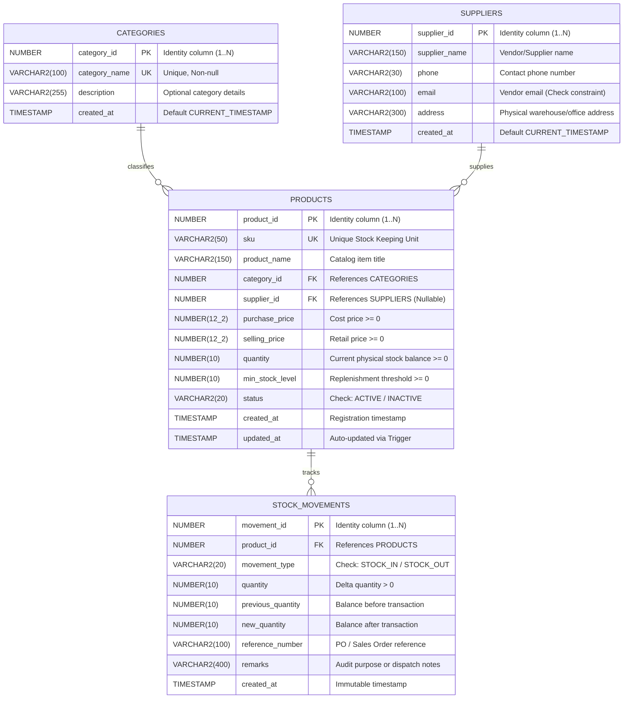

# SmartStock — Entity Relationship (ER) Diagram & Schema Specification

This document details the complete relational database architecture for the **SmartStock Inventory Management System** hosted on **Oracle Cloud Database 26ai**.

---

## 1. Visual Entity Relationship Diagram (Mermaid)

---

## 2. Table Specifications & Cardinality

### A. `CATEGORIES`
- **Purpose**: Groups products into distinct merchandise divisions (Electronics, Furniture, Stationery, etc.).
- **Primary Key**: `CATEGORY_ID` (Generated Always as Identity).
- **Unique Constraint**: `UQ_CATEGORY_NAME` ensures no duplicate categories.
- **Cardinality**: `1 Category` : `M Products` (One-to-Many).

### B. `SUPPLIERS`
- **Purpose**: Houses external vendor entities supplying inventory items.
- **Primary Key**: `SUPPLIER_ID` (Generated Always as Identity).
- **Constraints**: Format check on `EMAIL` (`LIKE '%_@__%.__%'`).
- **Cardinality**: `1 Supplier` : `M Products` (One-to-Many, with nullable foreign key in Products).

### C. `PRODUCTS`
- **Purpose**: Central catalog holding product attributes, pricing, and live inventory balances.
- **Primary Key**: `PRODUCT_ID` (Generated Always as Identity).
- **Foreign Keys**:
  - `CATEGORY_ID` &rarr; `CATEGORIES.CATEGORY_ID` (Enforces referential integrity).
  - `SUPPLIER_ID` &rarr; `SUPPLIERS.SUPPLIER_ID` (Nullable for self-manufactured or multi-sourced goods).
- **Constraints**:
  - `UQ_PRODUCT_SKU`: Guarantees SKU global uniqueness.
  - `CHK_PURCHASE_PRICE`: `PURCHASE_PRICE >= 0`
  - `CHK_SELLING_PRICE`: `SELLING_PRICE >= 0`
  - `CHK_PRODUCT_QTY`: `QUANTITY >= 0` (Database-level prevention of negative stock).
  - `CHK_MIN_STOCK`: `MIN_STOCK_LEVEL >= 0`
  - `CHK_PROD_STATUS`: `STATUS IN ('ACTIVE', 'INACTIVE')`
- **Trigger**: `TRG_PRODUCT_UPDATE_TIMESTAMP` updates `UPDATED_AT` on every modification.
- **Trigger**: `TRG_PREVENT_PRODUCT_DELETE` prevents physical deletion if historical movements exist.

### D. `STOCK_MOVEMENTS`
- **Purpose**: Permanent, auditable ledger tracking every single addition (`STOCK_IN`) and deduction (`STOCK_OUT`).
- **Primary Key**: `MOVEMENT_ID` (Generated Always as Identity).
- **Foreign Key**: `PRODUCT_ID` &rarr; `PRODUCTS.PRODUCT_ID`.
- **Constraints**:
  - `CHK_MOV_TYPE`: `MOVEMENT_TYPE IN ('STOCK_IN', 'STOCK_OUT')`
  - `CHK_MOV_QTY`: `QUANTITY > 0` (Zero and negative delta entries rejected).
  - `CHK_PREV_QTY`: `PREVIOUS_QUANTITY >= 0`
  - `CHK_NEW_QTY`: `NEW_QUANTITY >= 0`
- **Trigger**: `TRG_PREVENT_HISTORY_MUTATION` strictly disallows `UPDATE` and `DELETE` operations on this table, ensuring complete audit compliance.

---

## 3. High-Performance Indexing Strategy

| Index Name | Target Table | Target Columns | Purpose |
|---|---|---|---|
| `IDX_PROD_CAT` | `PRODUCTS` | `CATEGORY_ID` | Fast joins with `CATEGORIES` table. |
| `IDX_PROD_SUP` | `PRODUCTS` | `SUPPLIER_ID` | Fast vendor-product relationship queries. |
| `IDX_PROD_STATUS` | `PRODUCTS` | `STATUS` | Quick filtering of active catalog items. |
| `IDX_MOV_PROD` | `STOCK_MOVEMENTS` | `PRODUCT_ID` | Rapid historical ledger lookups by product. |
| `IDX_MOV_TYPE` | `STOCK_MOVEMENTS` | `MOVEMENT_TYPE` | Fast aggregation of Stock In vs Stock Out. |
| `IDX_MOV_DATE` | `STOCK_MOVEMENTS` | `CREATED_AT DESC` | High-speed retrieval for recent movements telemetry. |
